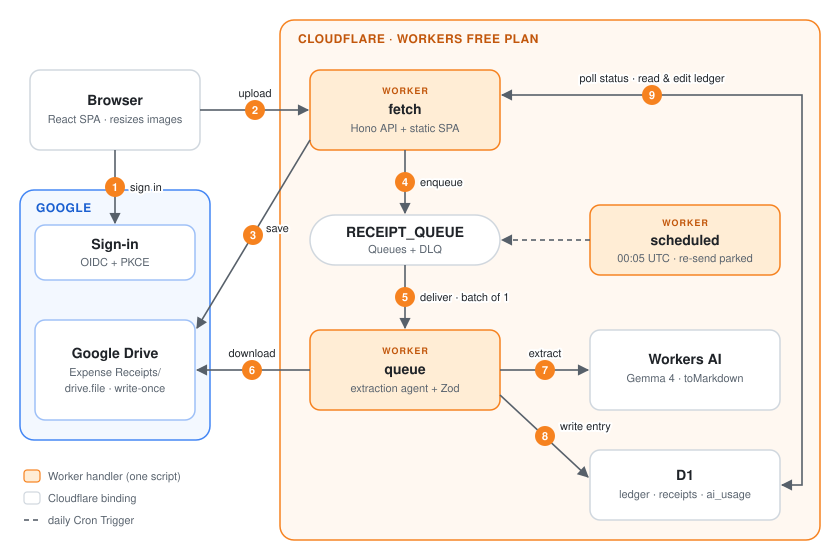

# Expense Tracker

Personal expense tracker for two users. Sign in with Google, upload a receipt (photo or PDF), and an AI agent extracts merchant, date, total, tax, currency and line items, picks a category, and records the expense in a per-category ledger. The original file is saved to `Expense Receipts/` in the user's own Google Drive.

The whole stack runs on the **Cloudflare Workers Free plan** ($0/month target).

> Full design: [`documents/Expense Tracker — Technical Spec.md`](./documents/Expense%20Tracker%20—%20Technical%20Spec.md)

## Status

**M3 (pipeline) implemented and locally verified** on `m3/pipeline` on Nov 16, 2026; PR review and staging verification remain. The 12-receipt eval re-run passed date accuracy (91.7%) but missed total accuracy (83.3% versus 90%); verification details and staging follow-ups are tracked in the plan ([`documents/M3 plan.md`](./documents/M3%20plan.md)). **M2 (sign-in + Drive upload) done**, verified locally with real Google accounts. M1 passed provisionally on 10 receipts ([`documents/M1 eval results.md`](./documents/M1%20eval%20results.md)). M2 adds Google sign-in, encrypted refresh tokens, the `Expense Receipts` Drive folder, uploads and the first D1 migrations ([`documents/M2 plan.md`](./documents/M2%20plan.md)). Work follows the spec's milestones:

| Milestone | Scope |
| --- | --- |
| M1 — Extraction spike | Worker + Workers AI only; 50-receipt eval; record accuracy and neurons/receipt |
| M2 — Auth + Drive | Google sign-in, encrypted refresh tokens, Drive folder, upload |
| **M3 — Pipeline** | Queue consumer, Zod validation, ledger writes, `ai_usage`, retries, quota parking (daily cron), status polling |
| M4 — Ledger UI | Category/month views, review & edit, categories, delete |
| M5 — Hardening & prod | CI/CD, prod env, limit banners, privacy policy, OAuth consent published |

## Stack

| Layer | Choice |
| --- | --- |
| Frontend | Vite + React + TypeScript, TanStack Query, Tailwind (static assets) |
| API | Hono on a single Cloudflare Worker (`fetch` + `queue` + `scheduled` handlers) |
| Auth | `oauth4webapi` (Google OIDC + PKCE), own `sessions` table |
| Database | Cloudflare D1 + Drizzle ORM |
| Async jobs | Cloudflare Queues (producer + consumer in the same Worker), DLQ |
| AI | Workers AI `@cf/meta/llama-3.2-11b-vision-instruct`; `env.AI.toMarkdown()` for PDFs |
| File storage | Google Drive API v3, `drive.file` scope |
| Validation | Zod (API bodies + LLM output) |
| Tooling | pnpm workspaces, Wrangler, Vitest + `@cloudflare/vitest-plugin`, GitHub Actions |
| Infrastructure | Pulumi (TypeScript, Pulumi Cloud state), `@pulumi/cloudflare` |

## How it works

One Worker script does everything: `fetch` serves the SPA and API, `queue` runs extraction, and `scheduled` re-sends receipts parked by the daily AI quota. D1 holds the ledger; the receipt files stay in each user's Google Drive.

<p align="center">
  <picture>
    <source media="(prefers-color-scheme: dark)" srcset="./documents/images/architecture-dark.svg">
    
  </picture>
</p>

1. **Sign in** with Google (OIDC + PKCE, `drive.file` scope only).
2. **Upload** a photo or PDF. The browser converts HEIC and resizes images first, keeping the Worker under its 10 ms CPU limit.
3. **Save** the file to the user's `Expense Receipts/` Drive folder. Drive is write-once: the app never edits or deletes files there.
4. **Enqueue** `{ receiptId, userId }` on `RECEIPT_QUEUE`, and the API returns `202` right away.
5. **Deliver** one message at a time to the `queue` handler.
6. **Download** the file back from Drive.
7. **Extract** merchant, date, totals and line items with Workers AI: one structured-output call, plus at most one repair call.
8. **Write** the ledger entry to D1. Zod and the post-validation rules decide `done` or `needs_review`.
9. **Poll** status from the SPA, then browse, review and edit the ledger.

When a free-plan limit runs out, the request fails instead of being billed. Each failure leaves the receipt in a recoverable state: retries with backoff, quota parking until the daily cron, or `failed` with a retry button.

## Repo layout (planned)

```text
documents/              Technical spec and other project docs
web/                    Vite + React SPA -> web/dist
worker/
  src/index.ts          Hono app: fetch + queue handlers
  src/auth/             OAuth, sessions, token encryption
  src/drive/            Drive API client
  src/agent/            Extraction prompt, Zod schema, post-validation
  src/db/               Drizzle schema + queries
  migrations/           D1 SQL migrations
  wrangler.jsonc        Local dev, bundling, remote migrations
infrastructure/
  foundation/           Pulumi: D1, queues (long-lived)
  services/             Pulumi: Worker deploy (per release)
.github/workflows/deploy.yml
```

## Prerequisites

- Node.js 22+ and pnpm 10+
- A Cloudflare account (Free plan) with two API tokens: provisioning and dev (see [Cloudflare tokens](#cloudflare-tokens))
- Pulumi CLI logged in to Pulumi Cloud (staging/production only)
- A Google Cloud project with the Drive API enabled

## Environments

| Env | URL | D1 | Queue | Provisioned by | Deploy trigger |
| --- | --- | --- | --- | --- | --- |
| local | `localhost:8787` | Local SQLite (Miniflare) | Local | — | `wrangler dev` |
| staging | `expense-tracker-staging.<sub>.workers.dev` | `expense-staging` | `receipts-staging` | Pulumi stack `staging` | Merge (push) to `main` |
| production | Custom domain or `expense-tracker.<sub>.workers.dev` | `expense-production` | `receipts-production` | Pulumi stack `production` | Published GitHub release `v*` on `main` |

## One-time setup

**Cloudflare + Pulumi:** provision staging and production with [`infrastructure/`](./infrastructure/README.md). `foundation` creates D1 and the queues; `services` holds the Worker config and secrets.

**Workers AI:** the Llama 3.2 Vision model requires accepting Meta's license once per Cloudflare account. Send one request to `@cf/meta/llama-3.2-11b-vision-instruct` with the prompt `agree` before the first real call.

**Google Cloud**

1. Configure the OAuth consent screen (External). Scopes: `openid`, `email`, `profile`, `https://www.googleapis.com/auth/drive.file`. Add both accounts as test users while building; publish to **In production** before daily use (avoids Testing mode's 7-day refresh-token expiry).
2. Create two OAuth Web clients (dev, prod) with redirect URIs:
   - `http://localhost:8787/auth/google/callback` (dev)
   - `https://expense-tracker-staging.<sub>.workers.dev/auth/google/callback` (dev)
   - `https://<production-origin>/auth/google/callback` (prod)

**GitHub repo secrets:** `CLOUDFLARE_API_TOKEN` (the provisioning token below), `CLOUDFLARE_ACCOUNT_ID`, `PULUMI_ACCESS_TOKEN`.

### Cloudflare tokens

Two custom API tokens, both scoped to this account only. Never reuse one for the other's job.

| Token | Used by | Account permissions |
| --- | --- | --- |
| `expense-tracker` (provisioning) | `pulumi up` for foundation/services, CI | D1 · Edit, Queues · Edit, Workers Scripts · Edit, Account Settings · Read (+ Zone · Workers Routes · Edit for a custom domain) |
| `expense-tracker-dev` | `wrangler dev`, the M1 eval | Workers AI · Read, Workers AI · Edit, Workers Scripts · Edit (remote-binding preview), Account Settings · Read. Set a TTL. |

The dev token has no D1 or Queues access, so it can't touch the staging or production databases.

## Local development

> The M1 eval needs only Cloudflare auth for Workers AI ([`worker/eval/README.md`](./worker/eval/README.md)). Sign-in and uploads also need the Google OAuth client from the spec's "One-time setup".

Local config comes from two git-ignored files. Each has a committed template listing every variable:

| File | Template | Read by | Holds | Needed from |
| --- | --- | --- | --- | --- |
| `worker/.env` | [`worker/.env.sample`](./worker/.env.sample) | Wrangler CLI | `CLOUDFLARE_API_TOKEN` (the **dev token**, see [Cloudflare tokens](#cloudflare-tokens)) | M1 |
| `worker/.dev.vars` | [`worker/.dev.vars.sample`](./worker/.dev.vars.sample) | The local Worker | Google OAuth client, `TOKEN_ENC_KEY`, `SESSION_SECRET`, `ALLOWED_EMAILS` | M2 |

```bash
cp worker/.env.sample worker/.env
cp worker/.dev.vars.sample worker/.dev.vars
```

Then fill in the values. The secrets guard (deny rules plus `.claude/hooks/protect-secrets.mjs`, shared with Codex) lets agents read and edit `*.sample` / `*.example` templates but never the real files. Staging and production take the same values as Pulumi secrets, not files (see [`infrastructure/README.md`](./infrastructure/README.md)).

```bash
pnpm install
pnpm --filter worker db:migrate:local
pnpm --filter web build        # or `pnpm --filter web dev` to rebuild on every change
pnpm --filter worker dev
```

Use Chrome or Firefox locally: the session cookie is `Secure`, which Safari may drop on `http://localhost`. Schema changes: edit `worker/src/db/schema.ts`, run `pnpm --filter worker db:generate`, check the SQL in `worker/migrations/` is additive, then migrate.

App runs at http://localhost:8787 with local D1 and Queues (Miniflare). Uploads are extracted by the local queue consumer. The daily cron (re-sends parked receipts and ones queued for over 24 h) doesn't run on its own locally; fire it with `curl "http://localhost:8787/cdn-cgi/handler/scheduled?cron=5+0+*+*+*"`. The top-level `wrangler.jsonc` config is local-only. Workers AI calls go to Cloudflare even in local dev and count against the daily neuron quota.

## Tests

```bash
pnpm -r test
```

Worker tests run inside the Workers runtime via `@cloudflare/vitest-plugin` and never call the real Workers AI.

## Deployment

CI runs tests, builds the SPA and Worker bundle, applies D1 migrations (`--remote`), then runs `pulumi up` on `infrastructure/services` for the target stack. `infrastructure/foundation` is applied manually. Details: [`infrastructure/README.md`](./infrastructure/README.md).

- **Migrations are additive only** in the same release as the code (new tables, nullable columns). Drop or rename only in a later release.
- **Rollback:** re-run the Deploy run of the previous release. Emergency: `wrangler rollback --name <worker>` (`expense-tracker-staging` or `expense-tracker`), then redeploy through CI. Restore D1 with `wrangler d1 time-travel` if a migration goes wrong.

## Free-plan limits

| Service | Daily limit (resets 00:00 UTC / 08:00 SGT) | Binds first? |
| --- | --- | --- |
| Workers AI | 10,000 neurons | **Yes** (~100–200 receipts/day) |
| Workers | 100,000 requests; 10 ms CPU/request | CPU per request is the tight one |
| Queues | 10,000 ops; 24 h retention | No |
| D1 | 5M rows read, 100k written | No |

Upgrade to Workers Paid ($5/month) when neurons regularly exceed ~8,000/day or CPU errors (1101) appear.

## Working with coding agents

- [`AGENTS.md`](./AGENTS.md) — project instructions for Codex and other agents (source of truth)
- [`CLAUDE.md`](./CLAUDE.md) — Claude Code entry point; imports `AGENTS.md`
- [`.claude/settings.json`](./.claude/settings.json) — Claude Code permissions
- [`.codex/config.toml`](./.codex/config.toml) — Codex project config
